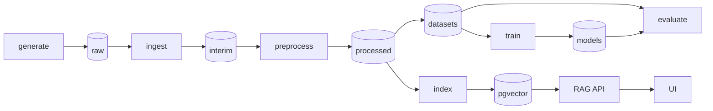

# necrohub

A reproducible pipeline for synthetic Brazilian Portuguese forensic necropsy reports: generate
labelled reports, de-identify them, fine-tune encoders on the generated gold labels, and answer
questions over the corpus with retrieval.

> **Synthetic data only. Not for clinical, medico-legal or forensic use.**
> Every report, name and identifier in this repository is generated or invented. A CI check fails
> the build when a file holds an identifier that is not on the fake allowlist.

## Status

Phase 1 of 8: scaffold, text normalization, section splitting, regex and Hugging Face NER
de-identification, hashing and Hugging Face embeddings, and the identifier leak check are in place. The generator, ingestion, DVC pipeline, training, retrieval API
and UI come in later phases. The design and the phase plan are in
[docs/REFACTOR_PLAN.md](docs/REFACTOR_PLAN.md), the decisions in [docs/DECISIONS.md](docs/DECISIONS.md).

## What this demonstrates

- Layered data flow: raw, interim, processed and serving layers with one owner per layer and
  deterministic, hash-checkable outputs.
- Typed contracts and quality gates: Pydantic v2 models with `extra="forbid"` at every boundary,
  and checks that fail a stage instead of passing bad data on.
- De-identification with a leak check in CI: context-anchored patterns that redact the value and
  keep the label, plus a check that fails on any identifier outside a committed fake pool.
- A reproducible pipeline: a pinned `uv.lock`, seeded generation, golden tests, and offline CI
  with no model downloads.
- Model fine-tuning on generated gold labels: exact character spans from the generator train and
  evaluate the NER and section encoders (planned).

## Architecture (target)



## Tech stack

Python 3.12, uv, Pydantic v2 and pydantic-settings, Typer, ftfy, NumPy. Planned: Hugging Face
Transformers and PyTorch (CPU wheels in CI), DVC, Postgres with pgvector, FastAPI, Streamlit,
Docker Compose. Quality: ruff, mypy strict, pytest, Hypothesis, pip-audit and zizmor in CI.

## Quickstart

```bash
uv sync --locked
make test                          # offline unit tests
make install-ml && make test-ml    # CPU torch + tiny-model tests, offline
uv run necrohub check-identifiers  # fail on identifiers outside the fake pool
uv run necrohub --version
```

`make help` lists the other targets. On Windows without `make`, run the `uv run` commands from the
Makefile directly.

## Project structure

```
src/necrohub/
  cli.py                 Typer app (check-identifiers; stage commands come later)
  settings.py            environment settings (NECROHUB_*)
  ids.py                 CPF/CNPJ check digits, identifier patterns, fake pool, leak check
  data/fake_identifiers.toml
  contracts/             Span, SectionSpan, ProcessedText
  preprocess/            normalize, sections, pipeline, deid/{base,regex,hf_ner}
  embed/                 Embedder protocol, token windows, hashing and Hugging Face embedders
tests/
  unit/                  offline tests
  ml/                    tiny local models (marker ml), offline
  external/              real model downloads (marker external, never in CI)
  fixtures/reports/      three synthetic reports
  golden/                expected outputs (pytest --update-golden rewrites them)
docs/                    refactor plan and decisions
```

## Origin

This repository merges the kept parts of three earlier prototypes, ragnosis, necropsy-hub and
necropsy-llm-hub, into one pipeline. Their history is not imported.

## License

MIT, see [LICENSE](LICENSE).
