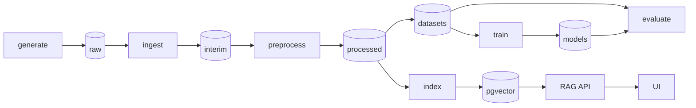

# necrohub

A reproducible pipeline for synthetic Brazilian Portuguese forensic necropsy reports: generate
labelled reports, de-identify them, fine-tune encoders on the generated gold labels, and answer
questions over the corpus with retrieval.

> **Synthetic data only. Not for clinical, medico-legal or forensic use.**
> Every report, name and identifier in this repository is generated or invented. A CI check fails
> the build when a text file holds a CPF or CNPJ with a valid check digit, or an RG, CRM, phone or
> e-mail that is not on the fake allowlist. It is a pattern check, not a guarantee: it cannot see
> names, addresses or identifiers written in forms it does not know.

## Status

Phase 2 of 8, first half: scaffold, text normalization, section splitting, regex and Hugging
Face NER de-identification, hashing and Hugging Face embeddings, the identifier leak check, and a
seeded template generator with exact gold labels are in place. The CLI has two commands:
`check-identifiers` and `generate`. PDF rendering and the LLM realizer (Ollama, optional Gemini)
finish phase 2. Ingestion, the DVC pipeline, training, the retrieval API and the UI come in later
phases. The design and the phase plan are in
[docs/REFACTOR_PLAN.md](docs/REFACTOR_PLAN.md), the decisions in [docs/DECISIONS.md](docs/DECISIONS.md).

## What this demonstrates

In place now:

- Seeded synthetic generation that samples structured case facts first and writes the report
  second, so every name, document number, date, injury, organ finding and cause of death has an
  exact character span. Runs are byte-identical for the same seed, every run writes a manifest,
  and a failed boundary check keeps the previous output.
- Typed contracts: Pydantic v2 models with `extra="forbid"` for spans, sections and processed
  text; `Span.verify` checks a span against the text it came from.
- De-identification with a leak check in CI: context-anchored patterns that redact the value and
  keep the label ("CPF nº [CPF]"), an optional Hugging Face NER detector, and a check that fails on
  identifier-shaped values outside a committed fake pool.
- Reproducible, offline checks: a pinned `uv.lock`, golden tests on synthetic reports, property
  tests, and CI that runs tiny local models with no downloads.

Planned (see the phase plan):

- Layered data flow: raw, interim, processed and serving layers, each written by one stage, with
  run metadata and hash-checkable outputs under DVC.
- Fine-tuning on those gold labels: exact character spans train and evaluate the NER and section
  encoders.

## Architecture (target)



## Tech stack

Python 3.12, uv, Pydantic v2 and pydantic-settings, Typer, ftfy, NumPy; Hugging Face
Transformers and PyTorch as the optional `ml` extra (CPU wheels in CI). Planned: DVC, Postgres with
pgvector, FastAPI, Streamlit, Docker Compose. Quality: ruff, mypy strict, pytest, Hypothesis, pip-audit and zizmor in CI.

## Quickstart

```bash
uv sync --locked
make test                          # offline unit tests
make install-ml && make test-ml    # CPU torch + tiny-model tests, offline
uv run necrohub check-identifiers  # fail on identifiers outside the fake pool
uv run necrohub generate --params params.yaml --out data/raw   # or: make generate
uv run necrohub --version
```

`make help` lists the other targets. On Windows without `make`, run the `uv run` commands from the
Makefile directly.

## Project structure

```
src/necrohub/
  cli.py                 Typer app (check-identifiers, generate)
  settings.py            environment settings (NECROHUB_*)
  params.py              typed sections of params.yaml
  runs.py                run manifests, atomic output swaps, tree hashes, JSONL io
  ids.py                 CPF/CNPJ check digits, identifier patterns, fake pool, leak check
  data/fake_identifiers.toml
  contracts/             Span, SectionSpan, ProcessedText, CaseFacts, GoldRecord
  generate/              vocab, sampler, templates/*.toml, realizers, fill, checks, stage
  preprocess/            normalize, sections, pipeline, deid/{base,regex,hf_ner}
  embed/                 Embedder protocol, token windows, hashing and Hugging Face embedders
tests/
  unit/                  offline tests
  ml/                    tiny local models (marker ml), offline
  external/              real model downloads (marker external, never in CI)
  fixtures/reports/      three synthetic reports
  golden/                expected outputs (pytest --update-golden rewrites them)
docs/                    refactor plan and decisions
params.yaml              pipeline parameters (seed, generate)
```

## Origin

This repository merges the kept parts of three earlier prototypes, ragnosis, necropsy-hub and
necropsy-llm-hub, into one pipeline. Their history is not imported.

## License

MIT, see [LICENSE](LICENSE).
