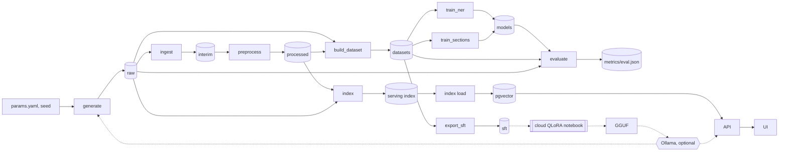

# necrohub

A reproducible pipeline over synthetic Brazilian Portuguese forensic necropsy reports: generate labelled reports, de-identify them, build typed datasets, fine-tune encoders, and answer questions over the corpus with retrieval.

Real necropsy reports cannot be shared, so the pipeline generates labelled synthetic ones. That lets de-identification, training and retrieval be built and tested end to end, and re-run by anyone.

[](https://github.com/emanuel-luis/necrohub/actions/workflows/ci.yml)
[](https://github.com/emanuel-luis/necrohub/actions/workflows/security.yml)
[](LICENSE)
[](pyproject.toml)

> **Synthetic data only. Not for clinical, medico-legal or forensic use.**
> Every report, name and identifier in this repository is generated or invented. A CI check fails
> the build when a text file holds a CPF or CNPJ with a valid check digit, or an RG, CRM, phone or
> e-mail that is not on the fake allowlist. It is a pattern check, not a guarantee: it cannot see
> names, addresses or identifiers written in forms it does not know.

## What this demonstrates

- A layered DVC pipeline with typed contracts and boundary checks: raw, interim, processed, datasets, models and a serving index, each written by one stage with a run manifest and metrics, and each stage safe to re-run (`dvc.yaml`, `src/necrohub/contracts/`).
- A reproducibility gate in CI: a clean run must reproduce the committed `dvc.lock` and `metrics/`, bit for bit for the data stages (`necrohub check-repro`).
- De-identification with a leak check, and a measured count of the PII that still reaches the serving index (`necrohub check-identifiers`, `gold_pii_strings_in_chunks` in `metrics/index.json`).
- Encoder fine-tuning and evaluation against a regex baseline, on a random split and on held-out templates (`metrics/eval.json`).
- A serving stack: pgvector index, FastAPI app, Streamlit UI and a Docker Compose setup with a smoke test (`compose.yaml`).

## Architecture



Solid arrows are the DVC pipeline and the serving path. Dashed arrows are optional side paths. Every stage also writes its own `metrics/<stage>.json`. The `index` and `evaluate` stages read `data/raw/gold` (the generator labels) for the PII leak metric and for the template of each test case.

## Tech stack

Python 3.12, uv, Pydantic v2, Typer, DVC, Hugging Face Transformers, PyTorch, FastAPI, Streamlit, Postgres with pgvector, Docker Compose, ruff, mypy, pytest, Hypothesis, GitHub Actions.

## Quickstart

Prerequisites: git, uv, Docker with Compose v2 (for `make up`), and make (see the Windows note below).

```bash
git clone https://github.com/emanuel-luis/necrohub.git
cd necrohub
make install-ml   # every extra, CPU torch
make demo         # dvc repro: generate to index, then a question
cp .env.example .env   # set POSTGRES_PASSWORD
make up           # db, loader, api, ui in Docker Compose
```

`make up` needs a finished `make demo`, since the stack loads `data/serving/index`. The UI is at http://127.0.0.1:8501 and the API at http://127.0.0.1:8000. `make down` stops the stack and deletes its volumes.

Windows may not have `make`. The same steps without it:

```bash
uv sync --locked --extra ml --extra cpu --extra pipeline --extra db --extra serve --extra ui
uv run --locked --extra pipeline dvc repro
uv run necrohub query "Qual a causa da morte no caso c7-00003?"
docker compose up -d --build --wait db loader api ui
```

`make demo` writes `data/raw`, `data/interim`, `data/processed`, `data/datasets`, `data/sft`, `data/serving` and `models/` (gitignored), plus `metrics/<stage>.json` and `metrics/eval.json` (committed). A second run does nothing, and `uv run dvc status` reports the pipeline up to date. There is no DVC remote: the data regenerates from the seed in `params.yaml`. The demo corpus is 24 cases at seed 7, trained on with tiny models from scratch on the CPU.

The committed model-stage metrics (`metrics/train_*.json`, `metrics/eval.json`) and `dvc.lock` come from Linux. On Windows or macOS, `make demo` rewrites them because model numerics differ slightly between operating systems (decision 17, below). This is expected. Discard it with `git restore metrics dvc.lock`.

Other commands:

```bash
make test                          # offline unit tests
make test-ml                       # tiny-model tests, offline (after make install-ml)
uv run necrohub check-identifiers  # fail on identifiers outside the fake pool
make help                          # every target
```

## Layers

Gold means the labels the generator writes with each report; they are exact because the text is built from them. A span is a labelled character range in a text. Detail on each stage is in [docs/PIPELINE.md](docs/PIPELINE.md).

| Layer | Path | Content | Contract | Written by | Checks |
| --- | --- | --- | --- | --- | --- |
| raw | `data/raw` | `reports/<case_id>.txt` (and `.pdf` for some cases), `gold/<case_id>.json`, `rejects.jsonl` | `GoldRecord` | `generate` | spans, required slots, leftover markers, unlabelled identifier-shaped values, reject budget |
| interim | `data/interim` | `ingested.jsonl`, `rejects.jsonl` | `IngestedDocument` | `ingest` | every gold record has a document, unique doc_id, no U+FFFD, PDF text length drift under `ingest.max_pdf_length_drift` |
| processed | `data/processed` | `documents.jsonl` (normalized text, sections, PII spans, redacted text), `rejects.jsonl` | `ProcessedDocument` | `preprocess` | ordered sections, coverage of 95% of non-whitespace characters, spans in bounds, no regex PII in redacted text |
| datasets | `data/datasets` | `{ner,sections,extraction,qa}/{train,validation,test}.jsonl`, `README.md` (dataset card) | `NerRecord`, `SectionRecord`, `ExtractionRecord`, `QaRecord` | `build_dataset` | no case in two splits, held-out templates stay in test, gold span align rejects under 0.05, no gold PII in extraction or QA |
| sft | `data/sft` | chat-format JSONL per split, `extraction.schema.json` | `CaseExtraction` | `export_sft` | no test case in train or validation, valid targets, no regex PII in messages |
| models | `models` | `encoder-{ner,sections}/` with `necrohub_train.json`; checkpoints in `models/.checkpoints/` | Hugging Face model directory | `train_ner`, `train_sections` | seeded, resumable |
| serving index | `data/serving/index` | `chunks.jsonl`, `embeddings.npy`, `index.json` | `Chunk`, `IndexInfo` | `index` | row, dimension, NaN and norm checks, no regex PII in chunks |
| metrics | `metrics` | one JSON per stage, plus `eval.json` | per stage | every stage, `evaluate` | compared by `check-repro` |

A failed boundary check fails the stage and leaves the previous layer in place. The generator also has an optional local LLM realizer, and a seeded share of the reports is rendered to PDF and read back with pypdf; both are described in [docs/PIPELINE.md](docs/PIPELINE.md).

## Data card

The corpus is 100% synthetic. Names come from Faker `pt_BR`, CPFs are checksum-invalid, and RG, CRM and phone values come from the committed fake pool (`src/necrohub/data/fake_identifiers.toml`). Ten scenarios (firearm homicide, sharp force, traffic, fall, hanging, drowning, cardiac and other natural deaths, poisoning, undetermined) and three template families produce the text. A held-out template is a family used only in the test split.

`build_dataset` writes a dataset card to `data/datasets/README.md` (generated, not committed) with provenance, split sizes, label histograms and the alignment reject rate. [docs/results/full-corpus.json](docs/results/full-corpus.json) pins the 1500-case reference corpus (seed 7, 397 PDFs, 47425 projected gold spans, none rejected) by sha256. Known limits are listed in [docs/PIPELINE.md](docs/PIPELINE.md).

## Models and results

The model card is [docs/MODEL_CARD.md](docs/MODEL_CARD.md). The demo models are small BERTs trained from scratch on the CPU. They check the pipeline and are not a result. `pucpr/biobertpt-clin` is the base for a full local run.

<!-- results:start -->
Results of the local GPU fine-tune are pending.
<!-- results:end -->

## Reproducibility

CI runs the demo on a clean Linux runner and fails unless `dvc status` is up to date and `dvc.lock` and `metrics/` match the committed files (`necrohub check-repro`). The gate has two levels:

- Data stages (generate, ingest, preprocess, build_dataset, export_sft, index) must reproduce bit for bit.
- Model stages (train_ner, train_sections, evaluate) must keep command, params, inputs, metrics structure and data-determined fields such as record and window counts, steps, dataset hashes, base model and seed. Model-determined values such as F1 and losses only warn beyond a tolerance. `--strict-models` makes them fail, for a rerun on the same machine.

The reason is [decision 17](docs/DECISIONS.md): elementwise ops and random draws differ at the last bit between Windows and Linux on the same CPU, and on WSL the tiny sections model diverged from the Windows run (val_loss 1.45 vs 1.31), so a tolerance gate on model outputs would be flaky by construction. Training is seeded and deterministic within one machine.

## Serving

```bash
uv run necrohub query "Qual a causa da morte no caso c7-00003?" --k 4   # answer and citations
uv run necrohub serve             # GET /healthz, POST /ask {"question": "...", "k": 4}
```

Both use the in-memory store over `data/serving/index` by default. The compose stack has four services: db (pgvector), loader (loads the index into pgvector), api and ui. `make smoke` runs the checks CI runs (needs curl and jq). The UI only talks to the API over HTTP (`NECROHUB_API_URL`), and `make ui` runs it without Docker.

To run `query` or `serve` against pgvector outside compose, start the database and set the variables yourself, because `necrohub` does not read `.env` (only compose does). The database listens on 127.0.0.1:5432; use the password from your `.env`.

```bash
docker compose up -d --wait db
export DATABASE_URL=postgresql://necrohub:<password>@localhost:5432/necrohub
export NECROHUB_STORE=pgvector
uv run necrohub index load
uv run necrohub serve
```

```powershell
docker compose up -d --wait db
$env:DATABASE_URL = "postgresql://necrohub:<password>@localhost:5432/necrohub"
$env:NECROHUB_STORE = "pgvector"
uv run necrohub index load
uv run necrohub serve
```

The `ollama` profile adds Ollama and a model pull, so answers come from a local model instead of the extractive default:

```bash
NECROHUB_LLM=ollama docker compose --profile ollama up -d --wait
```

## Cloud QLoRA notebook (optional, free T4)

`notebooks/qlora_extraction.ipynb` regenerates the 1500-case corpus from the seed, scores a base model, QLoRA-tunes `Qwen/Qwen3-4B-Instruct-2507` to extract the case facts as JSON, scores it again and exports a GGUF that `deploy/ollama/Modelfile` serves. It runs on a free T4 only, is committed without outputs and never runs in CI. The author has not run it yet, so there are no fine-tuned numbers. Steps and scorer are in [docs/PIPELINE.md](docs/PIPELINE.md).

## Project structure

```
src/necrohub/    package: contracts, one folder per stage, serving, CLI (tree in docs/PIPELINE.md)
tests/           unit (offline), ml (tiny models), external (downloads, never in CI), golden files
notebooks/       qlora_extraction.ipynb
deploy/ollama/   Modelfile for the QLoRA GGUF
docs/            DECISIONS.md, REFACTOR_PLAN.md, PIPELINE.md, results/
params.yaml      pipeline parameters
dvc.yaml         the pipeline; dvc.lock is its committed lock
metrics/         per-stage metrics, committed
Dockerfile, compose.yaml   the container stack
```

## Decisions

The design and the phase plan are in [docs/REFACTOR_PLAN.md](docs/REFACTOR_PLAN.md). The decisions, which override the plan, are in [docs/DECISIONS.md](docs/DECISIONS.md).

## Origin

This repository merges the kept parts of three earlier private prototypes (a retrieval-augmented question answering one, a necropsy report processing one and an LLM fine-tuning one) into one pipeline. Their history is not imported.

## License

MIT, see [LICENSE](LICENSE).
