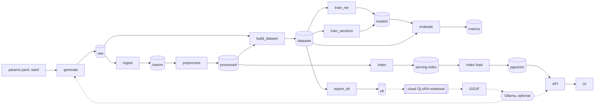

# necrohub

A reproducible pipeline over synthetic Brazilian Portuguese forensic necropsy reports: generate labelled reports, de-identify them, build typed datasets, fine-tune encoders, and answer questions over the corpus with retrieval.

[](https://github.com/emanuel-luis/necrohub/actions/workflows/ci.yml)
[](https://github.com/emanuel-luis/necrohub/actions/workflows/security.yml)
[](LICENSE)
[](pyproject.toml)

> **Synthetic data only. Not for clinical, medico-legal or forensic use.**
> Every report, name and identifier in this repository is generated or invented. A CI check fails
> the build when a text file holds a CPF or CNPJ with a valid check digit, or an RG, CRM, phone or
> e-mail that is not on the fake allowlist. It is a pattern check, not a guarantee: it cannot see
> names, addresses or identifiers written in forms it does not know.

## What this demonstrates

- Layered data flow with one writer per layer: raw, interim, processed, datasets, models and a serving index. Each stage writes a run manifest to `runs/<stage>/` and metrics to `metrics/<stage>.json` (`src/necrohub/runs.py`, `dvc.yaml`).
- Typed contracts at every boundary: Pydantic v2 models with `extra="forbid"` (`src/necrohub/contracts/`), and `Span.verify` checks a span against the text it came from.
- Quality checks that fail the run: spans out of bounds, section coverage, regex PII left in redacted text, a case in two splits, a gold PII value in a dataset record, index dimension and NaN checks. A failed run keeps the previous layer (`atomic_dir` in `src/necrohub/runs.py`).
- Idempotent, re-runnable stages: output is byte-identical for the same seed, and `tests/unit/test_idempotency.py` runs every stage through build-dataset twice and compares hashes.
- Seeded synthetic generation that samples structured case facts first and writes the report second, so every name, document number, date, injury, organ finding and cause of death has an exact character span (`src/necrohub/generate/`).
- Gold spans carried across PDF extraction and normalization by difflib projection, with the spans it cannot map counted instead of guessed (`src/necrohub/preprocess/align.py`, `metrics/preprocess.json`).
- De-identification with a leak check in CI: context-anchored patterns that keep the label ("CPF nº [CPF]"), an optional Hugging Face NER detector, and `necrohub check-identifiers`.
- One-command reproduction with a CI gate: `make demo` runs the DVC pipeline, and CI compares a clean run with the committed `dvc.lock` and `metrics/` (`necrohub check-repro`, `.github/workflows/ci.yml`).
- Encoder fine-tuning and evaluation: BIO NER and section classification with the Hugging Face `Trainer`, scored with strict and partial span F1 and PII character recall against the regex de-identifier, on a random split and on held-out templates (`src/necrohub/train/`, `src/necrohub/evaluate/`, `metrics/eval.json`).
- Serving: a pgvector index over redacted text, a FastAPI app, a Streamlit UI and a Docker Compose stack with a smoke test (`compose.yaml`, `scripts/compose_smoke.sh`).

## Architecture



Solid arrows are the DVC pipeline (`dvc.yaml`) and the serving path. Dashed arrows are optional side paths.

## Tech stack

Python 3.12, uv, Pydantic v2 and pydantic-settings, Typer, ftfy, NumPy, fpdf2, pypdf; Hugging Face Transformers and PyTorch as the optional `ml` extra (CPU wheels in CI); DVC as the `pipeline` extra. Postgres with pgvector (`db` extra, compose service) and FastAPI (`serve` extra). Streamlit (`ui` extra) and a Docker Compose stack (db, loader, api, ui, optional Ollama). Quality: ruff, mypy strict, pytest, Hypothesis, pip-audit and zizmor in CI.

## Quickstart

```bash
uv sync --locked
make install-ml   # every extra, CPU torch
make demo         # dvc repro: generate to index, then a question
make up           # db, loader, api, ui in Docker Compose
```

Before `make up`, run `cp .env.example .env` and set `POSTGRES_PASSWORD`; `make demo` must have finished, since the stack loads `data/serving/index`. The UI is at http://127.0.0.1:8501 and the API at http://127.0.0.1:8000. `make down` stops the stack and deletes its volumes.

On Windows, `make` may be missing. The equivalents are `uv run --locked --extra pipeline dvc repro` for `make demo` and `docker compose up -d --wait` for `make up` (add `--build db loader api ui` on the first run so the image is built).

`make demo` writes `data/raw`, `data/interim`, `data/processed`, `data/datasets`, `data/sft`, `data/serving` and `models/` (gitignored), plus `metrics/<stage>.json` and `metrics/eval.json` (committed). A second run does nothing; `uv run dvc status` reports the pipeline up to date. There is no DVC remote: the data regenerates from the seed in `params.yaml`. The demo corpus is 24 cases at seed 7 and the models are tiny ones trained from scratch on the CPU, so the demo checks the pipeline and is not a result.

Other commands:

```bash
make test                          # offline unit tests
make test-ml                       # tiny-model tests, offline (after make install-ml)
uv run necrohub check-identifiers  # fail on identifiers outside the fake pool
uv run necrohub generate --params params.yaml --out data/raw   # or: make generate
uv run necrohub ingest --in data/raw --out data/interim        # or: make ingest
uv run necrohub preprocess --in data/interim --out data/processed   # or: make preprocess
uv run necrohub build-dataset --processed data/processed --raw data/raw --out data/datasets   # or: make build-dataset
uv run necrohub --version
```

`make help` lists the other targets.

## Layers

| Layer | Path | Content | Contract | Written by | Checks |
| --- | --- | --- | --- | --- | --- |
| raw | `data/raw` | `reports/<case_id>.txt` (and `.pdf` for some cases), `gold/<case_id>.json`, `rejects.jsonl` | `GoldRecord` | `generate` | spans, required slots, leftover markers, unlabelled identifier-shaped values, reject budget |
| interim | `data/interim` | `ingested.jsonl`, `rejects.jsonl` | `IngestedDocument` | `ingest` | every gold record has a document, unique doc_id, no U+FFFD, PDF text length drift under `ingest.max_pdf_length_drift` |
| processed | `data/processed` | `documents.jsonl` (normalized text, sections, PII spans, redacted text), `rejects.jsonl` | `ProcessedDocument` | `preprocess` | ordered sections, coverage of 95 % of non-whitespace characters, spans in bounds, no regex PII in redacted text |
| datasets | `data/datasets` | `{ner,sections,extraction,qa}/{train,validation,test}.jsonl`, `README.md` (dataset card) | `NerRecord`, `SectionRecord`, `ExtractionRecord`, `QaRecord` | `build_dataset` | no case in two splits, held-out templates stay in test, align rejects under 0.05, no gold PII in extraction or QA |
| sft | `data/sft` | chat-format JSONL per split, `extraction.schema.json` | `CaseExtraction` | `export_sft` | no test case in train or validation, valid targets, no regex PII in messages |
| models | `models` | `encoder-{ner,sections}/` with `necrohub_train.json`; checkpoints in `models/.checkpoints/` | Hugging Face model directory | `train_ner`, `train_sections` | seeded, resumable |
| serving index | `data/serving/index` | `chunks.jsonl`, `embeddings.npy`, `index.json` | `Chunk`, `IndexInfo` | `index` | row, dimension, NaN and norm checks, no regex PII in chunks |
| metrics | `metrics` | one JSON per stage, plus `eval.json` | per stage | every stage, `evaluate` | compared by `check-repro` |

`ingest` reads a case from its PDF when it has one (pypdf text extraction; decision 13) and from its txt otherwise. `preprocess` normalizes, splits sections and de-identifies each document. A failed boundary check leaves the previous layer in place. `metrics/preprocess.json` also projects the gold spans from each raw txt onto the processed text and counts exact projections, projections with whitespace drift and rejects. PDF extraction drops blank lines and re-wraps long lines; a span cut by a line break still projects (its text becomes the processed slice, line break included), and only a span whose visible characters changed is rejected. At seed 7 every gold span projects: 765 exactly, 8 across a PDF line wrap.

## LLM realizer (optional, local)

The template realizer is the default and the only path in CI. For more varied text, a local
model writes the report body instead. It sees only non-identifying case facts and slot names and
writes placeholders such as `{{DECEDENT_NAME}}` and `[[CAUSE_OF_DEATH|...]]`; the same `fill()`
step then inserts the identifiers and labels the spans, so gold labels stay exact. Drafts that
drop a required slot, use an unknown one, leave a marker broken, write a PII value as literal text
(any CPF, RG, CRM, phone, e-mail, name, date, document number, address or CEP the regex
de-identifier finds outside a slot) or use characters outside latin-1 are rejected per case
into `rejects.jsonl`, retried with a new seed up to `generate.llm.max_attempts`, and the run fails
when rejects exceed `max_reject_fraction`. Typographic dashes, quotes and ellipses are
transliterated first and counted in `metrics/generate.json`.

```bash
# install Ollama from https://ollama.com, then:
ollama pull qwen3:4b-instruct-2507-q4_K_M   # about 2.5 GB, fits a 4 GB GPU
uv sync --locked --extra ollama
# set generate.realizer: llm in params.yaml (OLLAMA_HOST overrides http://localhost:11434)
uv run necrohub generate --params params.yaml --out data/raw
```

Gemini is an optional, paid backend: `uv sync --locked --extra genai`, export `GEMINI_API_KEY`
and set `generate.llm.backend: gemini` with a Gemini model name. LLM runs depend on the backend,
so only template runs are byte-reproducible.

## PDFs

A seeded `pdf_fraction` of the reports (default 0.25) is also rendered to
`reports/<case_id>.pdf` with fpdf2 core fonts and fixed metadata, so the bytes repeat across
runs, and `GoldRecord.files.pdf` points at it. The txt stays the source of the spans.
`check-identifiers` scans the text pypdf extracts from a PDF, and lists a PDF it cannot parse as
skipped.

## Datasets

`build-dataset` writes `data/datasets/<task>/{train,validation,test}.jsonl` for four tasks:
`ner` (one record per section with gold character spans of every entity label), `sections`
(section bodies without their header, labelled), `extraction` (redacted report text in, the
non-PII case facts out) and `qa` (fixed pt-BR questions answered from the gold case facts).
Splits are by case, seeded, 80/10/10 by default, and cases written with a held-out template
(`generate.holdout_templates`) go to test only. The run fails when splits share a case, a held-out
case leaves test, more than `dataset.max_align_reject_fraction` (0.05) of the gold spans cannot be
projected onto the processed text, a gold PII value shows up in an extraction input, target or QA
pair, or an NER span does not match its record text. The sections of a document that lost a span
to a projection reject are left out of `ner`. The extraction input is redacted with the projected
gold PII spans plus the regex detections, not with the regex alone, whose recall gaps P4 measures;
a case with a gold PII span that did not project is left out of `extraction` (none at seed 7).
The PII check compares with whitespace removed, so a value split by a line wrap is still caught.
The counts and the content sha256 of the layer are in `metrics/build_dataset.json`.

## Data card

The corpus is 100 % synthetic. Names come from Faker `pt_BR`, CPFs are checksum-invalid, and RG, CRM and phone values come from the committed fake pool (`src/necrohub/data/fake_identifiers.toml`). Ten scenarios (firearm homicide, sharp force, traffic, fall, hanging, drowning, cardiac and other natural deaths, poisoning, undetermined) and three template families produce the text.

`build_dataset` writes the dataset card to `data/datasets/README.md` (generated, not committed): provenance, the synthetic-only notice, split sizes, label histograms, the held-out template and the alignment reject rate. [docs/results/full-corpus.json](docs/results/full-corpus.json) pins the 1500-case reference corpus (seed 7, 397 PDFs, 47425 projected gold spans, none rejected) by sha256. Known limits: ETNIA, SEXO and standalone UF are not redacted in the extraction inputs (decision 11), template text is repetitive so scores on it are optimistic, a span whose visible characters change in extraction is rejected and its section is dropped, and Faker names may match real people by chance.

## Models and results

The model card is [docs/MODEL_CARD.md](docs/MODEL_CARD.md). The demo models (a small BERT trained from scratch on the CPU) check the pipeline and are not a result. `pucpr/biobertpt-clin` is the base for a full local run.

<!-- results:start -->
Results of the local GPU fine-tune are pending.
<!-- results:end -->

## Reproducibility

CI runs the demo on a clean Linux runner and fails unless `dvc status` is up to date and `dvc.lock` and `metrics/` match the committed files (`necrohub check-repro`). The gate has two levels:

- Data stages (generate, ingest, preprocess, build_dataset, index) must reproduce bit for bit.
- Model stages (train_ner, train_sections, evaluate) must keep command, params, inputs, metrics structure and data-determined fields such as record and window counts, steps, dataset hashes, base model and seed. Model-determined values such as F1 and losses only warn beyond a tolerance; `--strict-models` makes them fail, for a rerun on the same machine.

The reason is decision 17: elementwise ops and random draws differ at the last bit between Windows and Linux on the same CPU, and on WSL the tiny sections model diverged from the Windows run (val_loss 1.45 vs 1.31), so a tolerance gate on model outputs would be flaky by construction. Training is seeded and deterministic within one machine.

## Serving

```bash
uv run necrohub query "Qual a causa da morte no caso c7-00003?" --k 4   # answer and citations
uv run necrohub serve             # GET /healthz, POST /ask {"question": "...", "k": 4}
cp .env.example .env && docker compose up -d --wait db   # Postgres with pgvector
uv run necrohub index load        # needs DATABASE_URL; then NECROHUB_STORE=pgvector
```

The compose stack has four services: db (pgvector), loader (loads the index into pgvector), api and ui. `make smoke` runs the checks CI runs (needs curl and jq). The UI only talks to the API over HTTP (`NECROHUB_API_URL`); `make ui` runs it without Docker. The `ollama` profile adds Ollama and a model pull, so answers come from a local model:

```bash
NECROHUB_LLM=ollama docker compose --profile ollama up -d --wait
```

The index holds only redacted text. The default answerer is extractive and deterministic: it returns the sentence closest to the question and cites its chunk; `NECROHUB_LLM=ollama` or `gemini` answers from the retrieved context instead. A case id in the question limits the search to that case. `metrics/index.json` reports `gold_pii_strings_in_chunks`: the regex de-identifier still misses some names, and this counts the chunks where that reaches the index.

## Cloud QLoRA notebook (optional, free T4)

`necrohub export-sft` (DVC stage `export_sft`, `data/sft`) turns the `extraction` and `qa` records into chat-format JSONL (`{"messages": [...], "task", "id", "doc_id"}` per split, system prompts in pt-BR) plus `extraction.schema.json`, the JSON schema of the extraction target. `necrohub eval-extraction --data data/datasets --split test --predictions preds.jsonl --out results.json` scores raw model output (`{"id", "text"}` per line): valid JSON rate, exact accuracy per scalar field, set precision, recall and F1 for injuries and organ findings, and the rate of cases with every field right.

`notebooks/qlora_extraction.ipynb` (committed without outputs, never run in CI) regenerates the 1500-case corpus from the seed on a free T4, asserts its sha256 against `docs/results/full-corpus.json`, scores the base model, QLoRA-tunes `Qwen/Qwen3-4B-Instruct-2507` (decisions 22 and 23), scores it again with the same scorer, exports a Q4_K_M GGUF and writes `results/qlora_extraction.json` with scores, versions and wall times. **The author has not run it yet**, so there are no fine-tuned numbers; after a run, that file is copied to `docs/results/`. `deploy/ollama/Modelfile` serves the GGUF with `ollama create necrohub-extract -f deploy/ollama/Modelfile`. The model is a demonstration, not for clinical or forensic use.

## Project structure

```
src/necrohub/
  cli.py                 Typer app (check-identifiers, generate, ingest, preprocess, build-dataset,
                         export-sft, eval-extraction, train, evaluate, gpu-check, check-repro,
                         index build/load, query, serve, ui)
  settings.py            environment settings (NECROHUB_*, OLLAMA_HOST, GEMINI_API_KEY)
  params.py              typed sections of params.yaml
  runs.py                run manifests, atomic output swaps, tree hashes, JSONL io
  ids.py                 CPF/CNPJ check digits, identifier patterns, fake pool, leak check
  data/fake_identifiers.toml
  contracts/             Span, SectionSpan, ProcessedText, IngestedDocument, ProcessedDocument,
                         CaseFacts, GoldRecord, dataset records, serving records
  llm/                   ChatLLM protocol, Ollama and Gemini clients (optional extras)
  generate/              vocab, sampler, templates/*.toml, realizers, llm_realizer, prompts/,
                         fill, checks, render_pdf, stage
  ingest/                readers (txt, pdf with pypdf), stage
  preprocess/            normalize, sections, align, pipeline, stage, deid/{base,regex,hf_ner}
  datasets/              split (seeded, by case), build (task records), card, stage
  sft/                   chat-format export for the generative fine-tune
  embed/                 Embedder protocol, token windows, hashing and Hugging Face embedders
  index/                 index build and load, VectorStore protocol, in-memory and pgvector stores
  serve/                 RAG answerer, store runtime, FastAPI app, Streamlit UI, prompts/
  train/                 labels (BIO), tiny (from-scratch BERT), encoder (Trainer, predict), gpu, stage
  evaluate/              metrics (strict and partial span P/R/F1, PII recall, sections), extraction, stage
  repro.py               check-repro: data stages bit for bit, model stages on structure, warnings on drift
tests/
  unit/                  offline tests
  ml/                    tiny local models (marker ml), offline
  external/              real model downloads (marker external, never in CI)
  fixtures/reports/      three synthetic reports
  golden/                expected outputs (pytest --update-golden rewrites them)
deploy/ollama/           Modelfile for the QLoRA GGUF
notebooks/               qlora_extraction.ipynb
docs/                    refactor plan, decisions, results
params.yaml              pipeline parameters (seed, generate, ingest, preprocess, dataset, train, evaluate, embed, index, sft)
dvc.yaml, dvc.lock       DVC pipeline (`make demo`) and its committed lock
metrics/                 per-stage metrics, committed (DVC metrics, `cache: false`)
Dockerfile, compose.yaml the container stack
```

## Decisions

The design and the phase plan are in [docs/REFACTOR_PLAN.md](docs/REFACTOR_PLAN.md). The decisions, which override the plan, are in [docs/DECISIONS.md](docs/DECISIONS.md).

## Origin

This repository merges the kept parts of three earlier private prototypes (a retrieval-augmented question answering one, a necropsy report processing one and an LLM fine-tuning one) into one pipeline. Their history is not imported.

## License

MIT, see [LICENSE](LICENSE).
