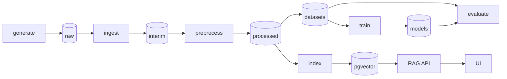

# necrohub

A reproducible pipeline for synthetic Brazilian Portuguese forensic necropsy reports: generate
labelled reports, de-identify them, fine-tune encoders on the generated gold labels, and answer
questions over the corpus with retrieval.

> **Synthetic data only. Not for clinical, medico-legal or forensic use.**
> Every report, name and identifier in this repository is generated or invented. A CI check fails
> the build when a text file holds a CPF or CNPJ with a valid check digit, or an RG, CRM, phone or
> e-mail that is not on the fake allowlist. It is a pattern check, not a guarantee: it cannot see
> names, addresses or identifiers written in forms it does not know.

## Status

Phase 3 of 8, in progress: scaffold, text normalization, section splitting, regex and Hugging Face NER
de-identification, hashing and Hugging Face embeddings, the identifier leak check, a seeded
template generator with exact gold labels, an optional LLM realizer (local Ollama, optional
Gemini) behind the same labelling step, PDF rendering of part of the reports, ingestion (PDF
text extraction) and the preprocess stage are in place. The CLI has four commands:
`check-identifiers`, `generate`, `ingest` and `preprocess`. The dataset build, the DVC pipeline,
training, the retrieval API and the UI come in later phases. The design and the phase plan are in
[docs/REFACTOR_PLAN.md](docs/REFACTOR_PLAN.md), the decisions in [docs/DECISIONS.md](docs/DECISIONS.md).

## What this demonstrates

In place now:

- Seeded synthetic generation that samples structured case facts first and writes the report
  second, so every name, document number, date, injury, abnormal organ finding and cause of death has an
  exact character span. Runs are byte-identical for the same seed, every run writes a manifest,
  and a failed boundary check keeps the previous output.
- Typed contracts: Pydantic v2 models with `extra="forbid"` for spans, sections and processed
  text; `Span.verify` checks a span against the text it came from.
- De-identification with a leak check in CI: context-anchored patterns that redact the value and
  keep the label ("CPF nº [CPF]"), an optional Hugging Face NER detector, and a check that fails on
  identifier-shaped values outside a committed fake pool.
- Reproducible, offline checks: a pinned `uv.lock`, golden tests on synthetic reports, property
  tests, and CI that runs tiny local models with no downloads.
- Layered data flow: raw, interim and processed layers, each written by one stage with a run
  manifest and boundary checks; rerunning the three stages gives byte-identical layers.
- Gold spans carried across PDF extraction and normalization by difflib projection, with the
  spans it cannot map counted instead of guessed.

Planned (see the phase plan):

- The datasets and serving layers, and DVC over the whole pipeline.
- Fine-tuning on those gold labels: exact character spans train and evaluate the NER and section
  encoders.

## Architecture (target)



## Tech stack

Python 3.12, uv, Pydantic v2 and pydantic-settings, Typer, ftfy, NumPy, fpdf2, pypdf; Hugging Face
Transformers and PyTorch as the optional `ml` extra (CPU wheels in CI). Planned: DVC, Postgres with
pgvector, FastAPI, Streamlit, Docker Compose. Quality: ruff, mypy strict, pytest, Hypothesis, pip-audit and zizmor in CI.

## Quickstart

```bash
uv sync --locked
make test                          # offline unit tests
make install-ml && make test-ml    # CPU torch + tiny-model tests, offline
uv run necrohub check-identifiers  # fail on identifiers outside the fake pool
uv run necrohub generate --params params.yaml --out data/raw   # or: make generate
uv run necrohub ingest --in data/raw --out data/interim        # or: make ingest
uv run necrohub preprocess --in data/interim --out data/processed   # or: make preprocess
uv run necrohub --version
```

### LLM realizer (optional, local)

The template realizer is the default and the only path in CI. For more varied text, a local
model writes the report body instead. It sees only non-identifying case facts and slot names and
writes placeholders such as `{{DECEDENT_NAME}}` and `[[CAUSE_OF_DEATH|...]]`; the same `fill()`
step then inserts the identifiers and labels the spans, so gold labels stay exact. Drafts that
drop a required slot, use an unknown one, leave a marker broken, write a PII value as literal text
(any CPF, RG, CRM, phone, e-mail, name, date, document number, address or CEP the regex
de-identifier finds outside a slot) or use characters outside latin-1 are rejected per case
into `rejects.jsonl`, retried with a new seed up to `generate.llm.max_attempts`, and the run fails
when rejects exceed `max_reject_fraction`. Typographic dashes, quotes and ellipses are
transliterated first and counted in `metrics/generate.json`.

```bash
# install Ollama from https://ollama.com, then:
ollama pull qwen3:4b-instruct-2507-q4_K_M   # about 2.5 GB, fits a 4 GB GPU
uv sync --locked --extra ollama
# set generate.realizer: llm in params.yaml (OLLAMA_HOST overrides http://localhost:11434)
uv run necrohub generate --params params.yaml --out data/raw
```

Gemini is an optional, paid backend: `uv sync --locked --extra genai`, export `GEMINI_API_KEY`
and set `generate.llm.backend: gemini` with a Gemini model name. LLM runs depend on the backend,
so only template runs are byte-reproducible.

### PDFs

A seeded `pdf_fraction` of the reports (default 0.25) is also rendered to
`reports/<case_id>.pdf` with fpdf2 core fonts and fixed metadata, so the bytes repeat across
runs, and `GoldRecord.files.pdf` points at it. The txt stays the source of the spans.
`check-identifiers` scans the text pypdf extracts from a PDF, and lists a PDF it cannot parse as
skipped.

### Layers

| Layer | Written by | Files |
| --- | --- | --- |
| raw | `generate` | `reports/<case_id>.txt` (and `.pdf` for some cases), `gold/<case_id>.json`, `rejects.jsonl` |
| interim | `ingest` | `ingested.jsonl` (one document per case), `rejects.jsonl` |
| processed | `preprocess` | `documents.jsonl` (normalized text, sections, PII spans, redacted text), `rejects.jsonl` |

`ingest` reads a case from its PDF when it has one (pypdf text extraction; decision 13) and from
its txt otherwise. `preprocess` normalizes, splits sections and de-identifies each document. Each
stage writes a manifest to `runs/<stage>/` and metrics to `metrics/<stage>.json`, and a failed
boundary check leaves the previous layer in place. `metrics/preprocess.json` also projects the
gold spans from each raw txt onto the processed text and counts the ones it could not map. PDF
extraction drops blank lines and re-wraps long lines, so a span cut by a line break is rejected.

`make help` lists the other targets. On Windows without `make`, run the `uv run` commands from the
Makefile directly.

## Project structure

```
src/necrohub/
  cli.py                 Typer app (check-identifiers, generate, ingest, preprocess)
  settings.py            environment settings (NECROHUB_*, OLLAMA_HOST, GEMINI_API_KEY)
  params.py              typed sections of params.yaml
  runs.py                run manifests, atomic output swaps, tree hashes, JSONL io
  ids.py                 CPF/CNPJ check digits, identifier patterns, fake pool, leak check
  data/fake_identifiers.toml
  contracts/             Span, SectionSpan, ProcessedText, IngestedDocument, ProcessedDocument,
                         CaseFacts, GoldRecord
  llm/                   ChatLLM protocol, Ollama and Gemini clients (optional extras)
  generate/              vocab, sampler, templates/*.toml, realizers, llm_realizer, prompts/,
                         fill, checks, render_pdf, stage
  ingest/                readers (txt, pdf with pypdf), stage
  preprocess/            normalize, sections, align, pipeline, stage, deid/{base,regex,hf_ner}
  embed/                 Embedder protocol, token windows, hashing and Hugging Face embedders
tests/
  unit/                  offline tests
  ml/                    tiny local models (marker ml), offline
  external/              real model downloads (marker external, never in CI)
  fixtures/reports/      three synthetic reports
  golden/                expected outputs (pytest --update-golden rewrites them)
docs/                    refactor plan and decisions
params.yaml              pipeline parameters (seed, generate, ingest, preprocess)
```

## Origin

This repository merges the kept parts of three earlier prototypes, ragnosis, necropsy-hub and
necropsy-llm-hub, into one pipeline. Their history is not imported.

## License

MIT, see [LICENSE](LICENSE).
